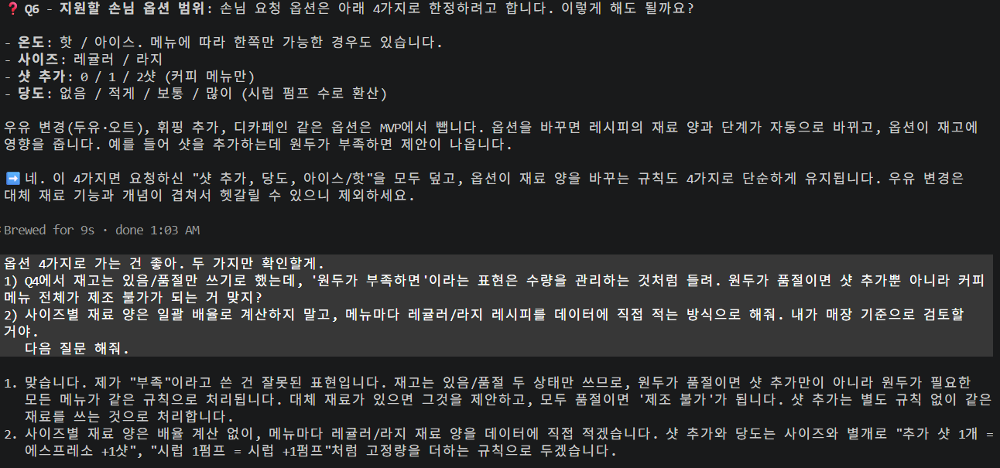
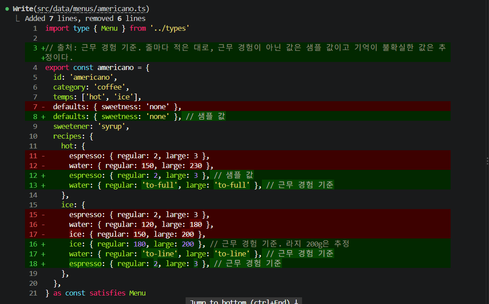
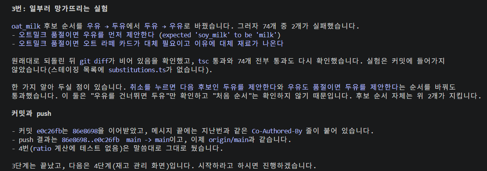
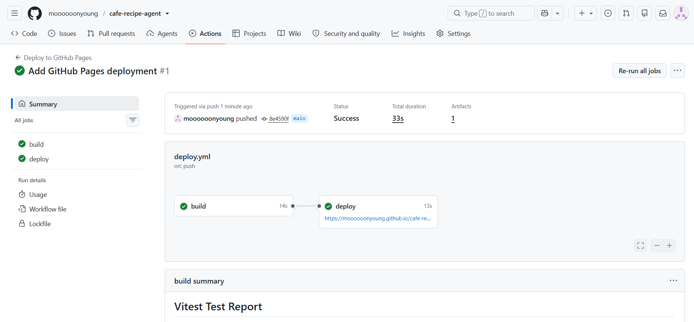
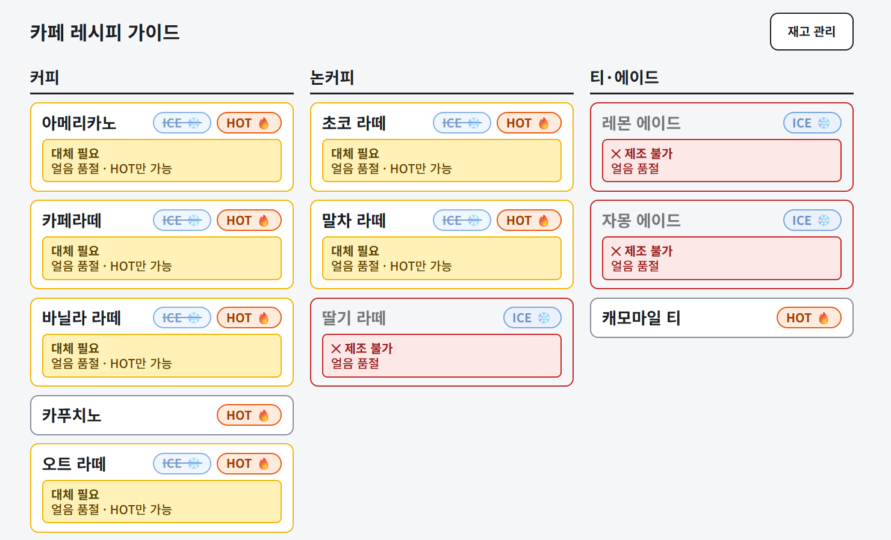
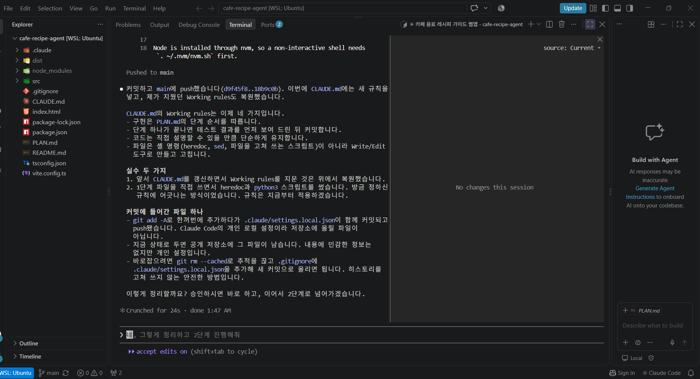

# 카페 레시피 가이드

## 1. 목적과 대상 사용자

카페 아르바이트생이 바쁜 매장에서 태블릿으로 음료 레시피를 빠르게 찾아보는 한국어 웹앱입니다. 읽기 쉽고 빨리 누를 수 있는 것을 기능 수보다 우선했습니다.

- **대상**: 가로 태블릿(터치)을 쓰는 매장 직원. 시연용으로 노트북 마우스 조작도 지원합니다.
- **핵심 기능**: 재고(있음/품절)에 따라 메뉴가 정상 / 대체 필요 / 제조 불가로 표시되고, 손님 옵션(온도·사이즈·샷 추가·당도)에 맞는 재료 양과 단계를 보여줍니다. 품절 재료는 대체 재료를 제안합니다.
- **LLM 없이 규칙 기반**입니다. 탭 한 번에 빠르게 답이 나오고, 같은 입력이면 결과가 항상 같고, 마감 안에 끝낼 수 있기 때문입니다. 에이전트 역할은 앱이 아니라 개발 도구인 Claude Code가 했습니다.

## 2. 실행·사용 방법

**배포 URL**: https://moooooonyoung.github.io/cafe-recipe-agent/

로컬 실행:

```
npm install
npm run dev     # http://localhost:5173/cafe-recipe-agent/
npm run check   # 타입 검사 + 테스트 + 빌드
```

사용 순서: 메뉴 카드 선택 → 옵션 확인 → 제조 가이드(단계를 탭하면 체크, 다시 탭하면 해제). 오른쪽 위 [재고 관리]에서 재료별 품절을 바꾸고, 초기화 버튼으로 기본값으로 되돌립니다. 재고는 브라우저 `localStorage`에 저장됩니다.

## 3. 작업 과정 요약

`PLAN.md`의 10단계 중 9단계(배포·기능 동결)까지 순서대로 끝냈고, 10단계는 이 README와 시연 영상입니다.

1. 설계: grill 스킬로 질문 12개에 답하며 `PLAN.md`를 만들었습니다.
2. 데이터와 규칙 로직: 레시피 초안을 Claude가 만들고, 제가 매장 기준으로 검토해 일부를 고쳤습니다. 대체 규칙은 제가 직접 검토해서 정했습니다(탄산수 → 물 삭제. 바닐라 시럽 → 시럽 삭제, 시럽 → 바닐라 시럽 유지). 규칙 로직은 화면과 분리해 Vitest로 검증했습니다.
3. 화면: 재고 관리 → 메뉴 선택 → 옵션 확인 → 제조 가이드 순으로 만들었습니다.
4. 화면 체크리스트: 태블릿 가로(1280×800)와 노트북 창에서 `PLAN.md` §4 항목을 모두 확인했습니다.
5. 배포: GitHub Pages. 계획(10/31)보다 이른 10/29에 끝내고 기능을 동결했습니다.

## 4. Claude Code 증거와 검증 결과

**자동 검증**: `npm run check`가 통과합니다(테스트 147개). 대표 사례(오트밀크 품절 → 우유 제안, 라지 + 샷 추가 → 4샷)와 엣지 케이스(탄산수 품절 → 에이드 제조 불가, 대체 후보가 모두 품절 → 제조 불가)를 포함하고, 레시피 데이터 검사(없는 재료 참조, 빠진 필드 등)도 테스트로 돌립니다.

**테스트가 실제로 잡아내는지 확인**: 대체 후보 순서(오트밀크 → 우유 → 두유)를 일부러 뒤집어 봤습니다. 테스트 74개 중 2개가 실패했고, 되돌린 뒤 `git diff`가 비어 있는 것과 전부 통과하는 것을 확인했습니다.


*사이즈별 재료 양도 "배율 계산" 대신 "메뉴마다 직접 적기"로 바꿨습니다.*



*Claude가 만든 레시피 초안을 제 근무 경험으로 고친 diff.*



*일부러 망가뜨리기 실험.*



*main에 push하면 `npm run check`를 서버에서 다시 돌리고, 통과해야만 배포됩니다.*

## 5. 효과적이었던 방식 3가지

1. **코드 전에 설계 질문부터 하기.**  처음에는 바로 화면을 만들고 싶었지만, Claude가 묻는 질문에 하나씩 답하면서 설계를 먼저 정했습니다. 재고를 "있음/품절" 두 가지로만 정해 두었는데, Claude가 손님 옵션을 설명하면서 "샷을 추가할 때 원두가 부족하면 제안이 나온다"고 답했습니다. "부족"이라는 것을 판단할 기준이 없어서 애매하다는 걸 바로 알아차리고 짚을 수 있었습니다. 설계를 먼저 정해 두니 에이전트의 제안이 맞는지 판단할 기준이 생겼습니다. 
2. **`CLAUDE.md`에 작업 규칙을 적기.** 처음에 이 과제를 하면서 걱정됐던 것은 Claude가 한 단계를 끝내면 제가 결과를 확인하기도 전에 커밋까지 해버릴 수도 있다는 점이었습니다. 만약 잘못된 방향으로 진행된 코드가 그대로 커밋되면 되돌리기가 복잡해지기 때문입니다. 그래서 CLAUDE.md에 "단계가 끝나면 테스트 결과를 나에게 먼저 보여주고, 확인 후에 커밋하기"라는 규칙을 세웠습니다. 이 이후로는 새 세션을 열어도 Claude가 "규칙대로 아직 커밋하지 않았습니다"라고 하면서 매번 멈추고 결과를 먼저 보여줬습니다. 매번 말로 부탁하는 것보다 규칙을 파일에 적어 두는 게 훨씬 편하다는 걸 알게 되었습니다.
3. **화면을 직접 보고 의견 제시하기.** 바쁜 매장에서 차가운 것과 따뜻한 것을 한눈에 구분되도록 파란색, 주황색으로 글자를 표시하자고 제안했습니다. 빨간색은 품절 같은 경고에 쓰고자 HOT은 주황색으로 정했고 추가적으로 불과 얼음 이모티콘도 넣어서 시각적으로 구분하기 수월하게 설계했습니다. Claude는 브라우저를 볼 수 없어서 화면 확인은 제가 했는데, 테스트가 모두 통과한 뒤에 화면을 직접 확인하다가 고칠 부분을 찾았습니다. 얼음이 품절인데 ICE 칩이 원래대로 파란색으로 보였습니다. 색만 보고 아이스가 되는 것으로 착각할 여지가 있다고 생각해서 안 되는 온도는 흐리게 하고 취소선을 긋도록 바꿨습니다. 또 오트밀크와 얼음이 동시에 품절이면 어떻게 되냐고 물어보니 얼음 품절만 나오고 오트밀크 대체는 보이지 않았습니다. 그래서 이 부분도 이유가 여러 개면 모두 보여주도록 고쳤습니다. 테스트는 미리 정한 경우만 확인해 주기 때문에, 생각하지 못한 경우는 사람이 직접 보고 물어봐야 찾을 수 있다는 것을 알게 되었습니다.



*화면을 보고 찾아 고친 문제. 안 되는 온도는 흐림과 취소선으로도 표시됩니다.*

## 6. 어려웠던 점 3가지와 대응

1. **에이전트가 지시를 놓침.** Claude는 똑똑해서 잘 해 줄 거라고 생각했는데, "하나씩 질문해줘"라는 요청에도 불구하고 질문 6개를 한꺼번에 줬습니다. 또 CLAUDE.md를 고치는 과정에서 제가 넣어둔 작업 규칙을 실수로 지워버리기도 했습니다. Claude가 자진해서 말해줘서 알게 되었지만, 모르고 넘어갔다면 그 뒤 작업은 규칙 없이 진행됐을 거라고 생각하니 많이 아찔했습니다. 같은 요청을 다시 보내 질문을 하나씩 받도록 바로잡았고, 지워진 규칙은 복원한 뒤에 "파일은 셸 명령이 아니라 편집 도구로 고칠 것"이라는 규칙을 추가했습니다. 에이전트에게 맡기더라도 결과는 제가 직접 확인해야 한다는 것을 깨달았습니다.
2. **개인 설정 파일이 공개 저장소에 올라감.** 커밋할 때마다 git 명령 승인 창이 뜨는 게 번거로워서 "다시 묻지 않기"를 골랐습니다. 그런데 바로 그 커밋에서 Claude가 git add -A로 바뀐 파일을 한꺼번에 올리다가, Claude Code의 개인 설정 파일까지 함께 push됐습니다. 비밀번호나 API 키는 없었지만 공개적인 공간에 개인 설정이 올라갔다는게 당황스러웠고, 승인을 생략한 제 선택도 원인이었다는 것을 알게 되었습니다. git rm --cached로 파일은 남겨 둔 채 추적만 끊고, .gitignore에 추가해서 다시 올라가지 않게 했습니다. 한꺼번에 올리는 명령은 의도하지 않은 파일까지 올릴 수 있으니, 편함을 추구하고자 확인하는 과정을 건너뛰기보다는 커밋 전에 어떤 파일이 들어가는지 확인해야 한다는 것을 배웠습니다. 
3. **카페 레시피가 대부분 기억나지 않음.** 카페에서 아르바이트를 했었지만 레시피는 거의 잊어버려서, Claude가 만든 레시피 초안으로 따라가야겠다고 생각했습니다. 하지만 그래도 제 경험을 살릴 수 있는 부분은 직접 고치는 것이 좋겠다고 마음을 바꿨습니다. 확실히 기억나는 아이스 아메리카노, 핫 아메리카노, 아이스 라떼만 실제로 제가 만들던 방식대로 레시피를 바꿨습니다. 예를 들어 아이스 아메리카노는 얼음을 먼저 담고, 물은 ml로 재지 않고 컵에 그어진 선까지 부은 뒤 샷을 마지막에 넣었습니다. 나머지 메뉴는 샘플 값으로 두고, 코드 주석과 README에 "근무 경험 기준","샘플 값","추정"을 구분해서 적었습니다. 아직 대부분의 레시피는 실제 매장 기준이 아니라서 실제로 쓰려면 검토가 더 필요합니다. 모르는 값을 아는 척 채우기보다는 어디까지가 확인된 값인지 밝히는 게 중요하다고 생각했습니다.



*에이전트의 실수 두 가지를 Claude가 스스로 보고한 장면.*

## 7. 알려진 한계

- **레시피의 대부분은 샘플 값입니다.** 제 근무 경험 기준으로 검토한 것은 아이스 아메리카노, 아이스 라떼, 핫 아메리카노뿐입니다. 그마저도 일부 값은 샘플이거나 추정입니다(아이스 라떼의 재료 양, 핫 아메리카노의 샷 수는 샘플 값, 라지 아이스 아메리카노의 얼음 200g은 추정). 나머지 메뉴, 메뉴 구성, 당도별 시럽 펌프 수, 기본 옵션은 실제 매장 검토 전의 샘플 값입니다. 값마다 코드 주석에 출처가 있습니다.
- 메뉴 카드의 '대체 필요' 이유는 옵션 **하나**(온도 또는 당도)만 바꿔서 만들 수 있을 때만 나옵니다. 두 옵션을 함께 바꿔야 하면 '제조 불가'로 표시됩니다.
- 새로고침하면 재고는 유지되지만, 보고 있던 화면(옵션·가이드)과 체크한 단계는 사라지고 메뉴 화면으로 돌아갑니다.- 화면은 자동 테스트 없이 눈으로 확인했습니다. 버튼 크기는 CSS 최소값(56px 이상)을 코드로 점검했을 뿐 실측하지는 않았습니다. 실제 태블릿이 아니라 크롬 개발자 도구의 1280×800 화면에서 확인했습니다.
- LLM 자유 입력, 영어 UI, 다크 모드, 메뉴 검색 같은 선택 기능은 만들지 않았습니다.

## 8. 채점용 핵심 소스 파일

- `src/logic/status.ts`: 메뉴·옵션 상태(정상 / 대체 필요 / 제조 불가)와 배지 이유를 계산합니다.
- `src/logic/substitution.ts`: 품절 재료의 대체 후보 제안과 적용·취소를 처리합니다.
- `src/logic/recipe.ts`: 옵션에 따른 재료 목록과 양을 계산합니다.
- `src/data/data.test.ts`: 레시피·대체 규칙 데이터의 참조가 올바른지 검사합니다.
- `src/screens/GuideScreen.tsx`: 제조 가이드 화면입니다.
